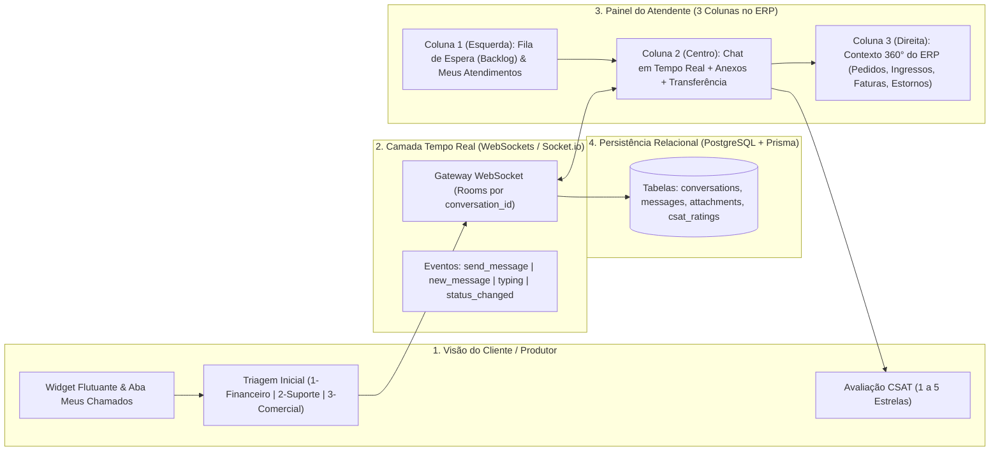

# Arquitetura Oficial — Módulo de Chat Interno & Help Desk em Tempo Real (SafeSaff ERP)

**Stack Base do Ecossistema SafeSaff:**
- **Frontend:** React 19 + TypeScript + Tailwind CSS (Shell Enterprise Limitless V7)
- **Backend / API:** Node.js + Express / Serverless API + WebSockets (`Socket.io` + `BroadcastChannel` + SSE Fallback)
- **Banco de Dados:** PostgreSQL (Neon Serverless) + Prisma ORM (`prisma/schema.postgresql.prisma`)

---

## 1. Visão Geral da Arquitetura em 4 Camadas



---

## 2. Modelagem de Dados (Prisma / PostgreSQL)

```prisma
enum ConversationStatus {
  PENDING   // Na fila de espera (Backlog)
  ACTIVE    // Em atendimento por um operador
  RESOLVED  // Resolvido (aguardando avaliação CSAT)
  CLOSED    // Encerrado definitivamente
}

enum SupportDepartment {
  FINANCEIRO
  SUPORTE_TECNICO
  COMERCIAL
  SAC_INGRESSOS
  ESTORNO
}

enum SenderType {
  CLIENT
  ATTENDANT
  SYSTEM_BOT
}

model HelpdeskConversation {
  id              String             @id @default(uuid())
  protocol        String             @unique // Ex: HD-2026-009481
  clientId        Int                @map("client_id")
  producerId      Int?               @map("producer_id")
  eventId         Int?               @map("event_id")
  attendantId     Int?               @map("attendant_id") // Nulo enquanto estiver na fila (PENDING)
  department      SupportDepartment  @default(SUPORTE_TECNICO)
  subject         String
  status          ConversationStatus @default(PENDING)
  priority        String             @default("NORMAL") // BAIXA | NORMAL | ALTA | URGENTE
  csatScore       Int?               @map("csat_score") // 1 a 5 estrelas
  csatComment     String?            @map("csat_comment")
  lastMessageAt   DateTime           @default(now()) @map("last_message_at")
  resolvedAt      DateTime?          @map("resolved_at")
  closedAt        DateTime?          @map("closed_at")
  createdAt       DateTime           @default(now()) @map("created_at")
  updatedAt       DateTime           @updatedAt @map("updated_at")

  messages        HelpdeskMessage[]

  @@index([clientId, status])
  @@index([attendantId, status])
  @@index([department, status])
  @@map("conversations")
}

model HelpdeskMessage {
  id              String               @id @default(uuid())
  conversationId  String               @map("conversation_id")
  senderId        Int                  @map("sender_id")
  senderName      String               @map("sender_name")
  senderType      SenderType           @map("sender_type")
  content         String
  attachmentUrl   String?              @map("attachment_url")
  attachmentName  String?              @map("attachment_name")
  readAt          DateTime?            @map("read_at")
  createdAt       DateTime             @default(now()) @map("created_at")

  conversation    HelpdeskConversation @relation(fields: [conversationId], references: [id], onDelete: Cascade)

  @@index([conversationId, createdAt])
  @@map("messages")
}
```

---

## 3. Contrato de Eventos em Tempo Real (WebSocket / Socket.io)

| Evento | Direção | Payload | Responsabilidade |
| :--- | :--- | :--- | :--- |
| `join_conversation` | Cliente/Atendente → Servidor | `{ conversationId, userId, role }` | Valida RBAC (se o cliente é dono do chamado ou se o atendente pertence ao departamento) e inscreve o socket na room `conv:{conversationId}`. |
| `send_message` | Cliente/Atendente → Servidor | `{ conversationId, content, attachmentUrl? }` | Persiste na tabela `messages`, atualiza `last_message_at` em `conversations` e emite `new_message`. |
| `new_message` | Servidor → Room `conv:{id}` | `{ id, conversationId, senderId, senderType, content, createdAt }` | Injeta a mensagem instantaneamente na tela do cliente e no painel do atendente sem reload. |
| `typing_indicator` | Bidirecional | `{ conversationId, senderName, isTyping }` | Exibe *"Atendente está digitando..."* ou *"Cliente está digitando..."*. |
| `claim_conversation` | Atendente → Servidor | `{ conversationId, attendantId }` | Tira a conversa da **Fila de Espera (`PENDING`)** e move para **Meus Atendimentos (`ACTIVE`)**. |
| `transfer_department` | Atendente → Servidor | `{ conversationId, targetDepartment, note }` | Transfere o chat entre `FINANCEIRO`, `SUPORTE_TECNICO`, `COMERCIAL` ou `ESTORNO` registrando mensagem de sistema no histórico. |
| `resolve_conversation` | Atendente → Servidor | `{ conversationId }` | Altera status para `RESOLVED` e dispara o cartão de avaliação **CSAT (1 a 5 estrelas)** para o cliente. |

---

## 4. Layout Operacional de 3 Colunas no ERP (Painel do Atendente)

1. **Coluna 1 — Filas & Caixa de Entrada (`Esquerda`):**
   - Abas rápidas: **Fila de Espera (`pending`)**, **Meus Atendimentos (`active`)** e **Resolvidos (`resolved`)**.
   - Filtro por Departamento (`1 - Financeiro`, `2 - Suporte Técnico / Sistema`, `3 - Comercial`, `4 - Estornos`).
   - Indicador de SLA, tempo de espera e contador de mensagens não lidas.
2. **Coluna 2 — Conversa em Tempo Real (`Centro`):**
   - Cabeçalho com protocolo (`#HD-2026-...`), status, botões **Assumir Atendimento**, **Transferir Setor** e **Encerrar / Solicitar CSAT**.
   - Histórico paginado de mensagens com carimbo de data/hora, suporte a anexos (prints, comprovantes PIX, notas fiscais) e indicador *"digitando..."*.
3. **Coluna 3 — Contexto 360° do Cliente no ERP (`Direita`):**
   - Exibe automaticamente os dados reais do cliente/produtor diretamente do banco do SafeSaff sem sair da tela:
     - **Empresa / Produtora / CPF-CNPJ**
     - **Pedidos Recentes & Ingressos Emitidos (8 dígitos)**
     - **Faturas / Repasses / Borderôs & Solicitações de Estorno**
     - **Histórico de Chamados Anteriores & Nota Média CSAT**
